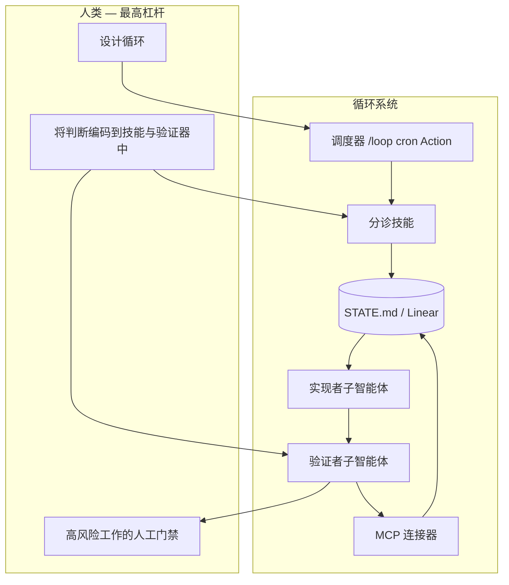

# 概念与词汇

循环工程隶属于一系列关于智能体驱动软件开发的思想。本词汇表将这些概念串联起来，帮助您以正确的思维模型设计循环。

## 循环工程

**取代自己作为提示者的角色。** 您设计一个系统，让它自行发现工作、分配任务、验证结果并持久化状态——而不是亲自输入下一个提示。

循环是一个**递归目标**：定义目的，让智能体（借助子智能体和外部记忆）持续迭代，直到完成或升级交由人工处理。

## 相关概念（Addy Osmani）

### 智能体环境工程

**单个智能体**运行的环境：工具、上下文、权限、规则。环境是沙箱；循环是**随时间调度和编排**环境运行的系统。

```
环境 = 单次会话设置
循环 = 环境 + 调度 + 状态 + 验证链
```

### 工厂模型

**构建**软件的系统：流水线、智能体、检查与交接。循环工程是您运营工厂车间的方式——而非手动组装每个单元。

### 意图债务

每次会话，智能体都从零开始。缺失的意图会被自信的猜测所填补。**技能**是您偿还意图债务的方式——约定、构建步骤和“我们不这样做”的规则，只需书写一次，每次运行都会读取。

### 理解债务

仓库中实际存在的内容与您真正理解的内容之间的差距。更快的循环会产出更多您未曾编写的代码——除非您**阅读循环所生成的内容**，否则理解债务会不断增长。

### 认知放弃

让循环自行运转而您不再持有主见的陷阱。带着判断力设计循环是解药；利用循环逃避思考是催化剂。同样的行为，截然相反的结果。

### 编排税

协调并行智能体的人力成本：审查带宽、合并冲突、上下文切换。**工作树**消除了机械性冲突；您自身仍是能够吸收多少并行循环的上限。

### 代码智能体乐团 / 对抗性代码审查

结构性模式：不同角色（探索、实现、验证）的不同智能体。实现者绝不能给自己的作业打分。这对于**无人值守**的循环至关重要。

## 六大原语（+ 记忆）

参见 [primitives.md](./primitives.md) 和 [primitives-matrix.md](./primitives-matrix.md)。

1. 自动化 / 调度
2. 工作树
3. 技能
4. 插件与连接器（MCP）
5. 子智能体（实现者 / 验证者）
6. **+ 记忆 / 状态**（外部、持久化）

## 概念图



## 下一步

- [循环设计清单](./loop-design-checklist.md) — 在发布循环之前
- [故障模式](./failure-modes.md) — 当循环出错时
- [运营循环](./operating-loops.md) — 成本、日志、何时暂停
- [安全](./safety.md) — 生产环境的防护栏